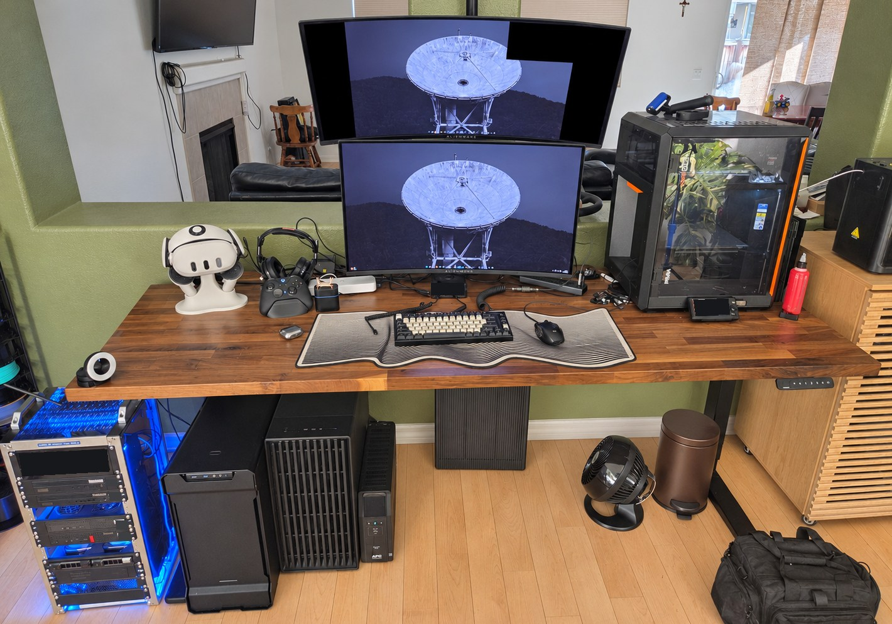
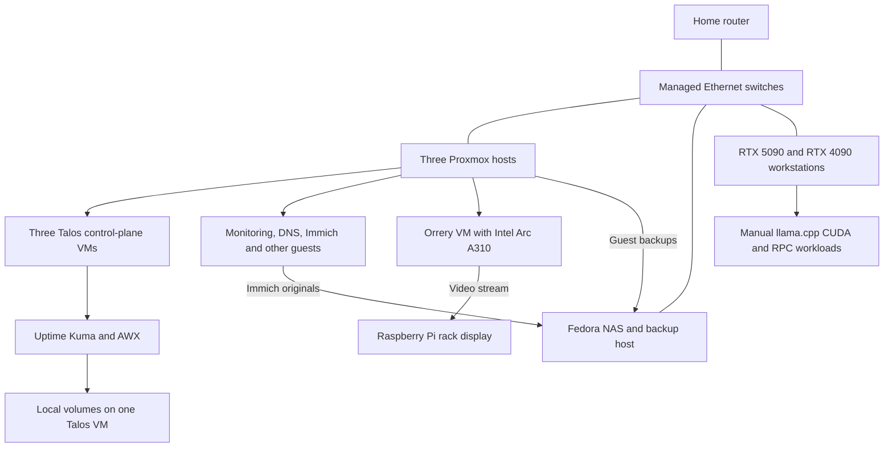

# Homelab

A small rack, two GPU workstations, and a fairly persistent list of things to fix. I use this lab to work on networking, Linux, virtualization, Kubernetes, automation, and local AI infrastructure. It also runs services I use at home, including photo storage and monitoring.

*The lab on November 10, 2026. This photo has light AI-assisted retouching and privacy redactions; [photo notes](images/README.md) describe the edits. The [rack close-up](projects/proxmox.md) uses an original photograph.*

## Projects

**[Network Orrery](projects/network-orrery.md).** The network as a planetary system: physical hosts are planets, their guests are moons, and live telemetry supplies the readings. The rack edition renders on a passed-through Intel Arc A310 and streams to a Raspberry Pi display. A separate WebGPU version runs on the 4090 workstation. The page includes recordings and the actual rendering path.

**[Desktop tools](projects/desktop-tools.md).** GPU and system telemetry, per-monitor HDR controls, a DDC/CI input switch, and a small dock that hides their windows without stopping the tools. The interesting problems are sample freshness, process ownership, and deciding when a hardware command has actually succeeded.

**[Talos and Kubernetes](projects/talos.md).** Three control-plane VMs run Talos 1.13.8 and Kubernetes 1.36.2. [Uptime Kuma](kubernetes/uptime-kuma/README.md) and AWX use local-path volumes. The notes and proposed Kuma manifest cover service checks, single-writer storage, and what happens when the VM holding the data is unavailable.

**[Proxmox and recovery](projects/proxmox.md).** Five guests use Proxmox HA with asynchronous ZFS replication. Backups are a separate concern. The recovery checklist follows a guest through storage and application checks, supported by an offline [backup freshness checker](automation/README.md#backup-freshness).

**[Local GPU inference](projects/gpu-inference.md).** Native Windows llama.cpp uses CUDA locally and an RPC worker on the other workstation. Saved tests show inference with an 80B model across both GPUs. The services start manually; the current review found stale network assumptions that need fixing before the next run.

**[Homepage and services](projects/homepage.md).** The dashboard is my front door to the lab, with host readings, backup status, SSH launchers, and service controls. [Monitoring notes](projects/monitoring.md) follow the data through Prometheus, Grafana, and Kuma, including a collector bug that made an empty response look healthy.

## The lab

Three Lenovo Tiny systems run Proxmox. A fourth runs Fedora for file storage, backups, and administration. The GPU workstations handle inference separately from the services in the rack. This inventory was checked on November 10, 2026.

| System | CPU | RAM | Role |
| --- | --- | --- | --- |
| ThinkCentre M90q Gen 5 | Core i9-14900 | 32 GB | Proxmox |
| ThinkCentre M90q Gen 3 | Core i9-12900T | 32 GB | Proxmox |
| ThinkStation P330 Tiny | Core i7-9700T | 24 GB | Proxmox |
| ThinkCentre M920q | Core i5-8500T | 32 GB | Fedora NAS and backup host |
| GPU workstation | Ryzen 9 9950X | 64 GB | RTX 5090, 32 GB VRAM |
| GPU workstation | Ryzen 7 7800X3D | 32 GB | RTX 4090, 24 GB VRAM |

The Proxmox hosts use local ZFS storage. The NAS has an 8 TB data disk and a separate 4 TB backup disk. Neither arrangement provides local disk redundancy. Managed Ethernet connects the lab; the Proxmox links currently run at 1 Gbps.

## Architecture

This is a logical dependency diagram, not a cable or VLAN map. The Talos VMs also run application workloads. Their local volumes and the NAS remain important failure points; three control-plane nodes do not make every application highly available.

## What I'm working on

The next useful work is fairly practical: test a full restore of Kuma and the photo library, add resource metrics and probes to Kubernetes, and validate the inference launcher's network assumptions after address changes. A GitOps rollout can follow once storage and recovery behavior are documented. These are proposed improvements, not completed deployments.

The [automation directory](automation/README.md) contains offline checks and examples. [Validation instructions](CONTRIBUTING.md) cover code, manifests, links, and publication checks. [Media notes](images/README.md) describe the photographs, screenshots, and short recordings. Credentials and the private network map stay outside this repository.
