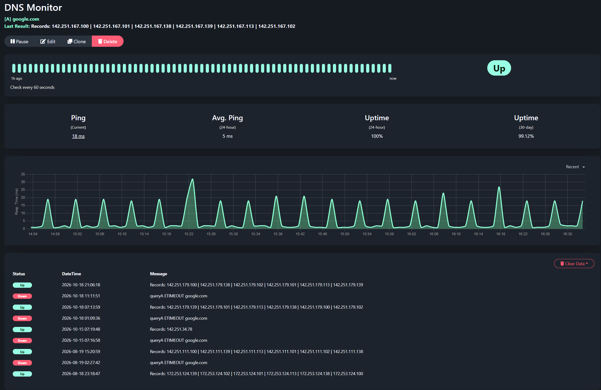
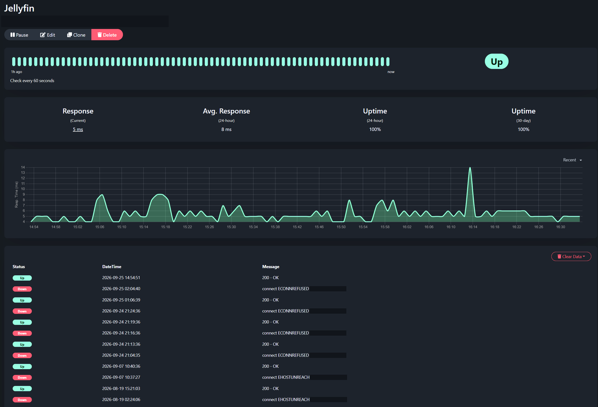

# Uptime Kuma on local storage

The running deployment has one replica, a `Recreate` update strategy, and a 2 GiB local-path PVC. It uses the `louislam/uptime-kuma:1` image tag and a NodePort Service. The November 10, 2026 check found its current pod Ready, but no Kubernetes startup/readiness/liveness probes or resource requests and limits were configured.

`Recreate` makes the single-writer arrangement explicit during updates. It also means a deployment update interrupts the service. The volume is bound to one Talos VM, so another Ready node does not automatically provide another copy of Kuma's data.

## What the checks tell me



*DNS check captured November 10, 2026. The history includes real query timeouts and later recoveries. The percentages belong to this monitor and its displayed windows; they are not an availability claim for the lab.*

The DNS monitor makes an A-record query. It checks a different path from a host ping, which can succeed while resolution fails. Its response-time graph gives me a place to start investigating, but a spike alone does not identify whether the delay was local, upstream, or in the monitoring path.

The Jellyfin HTTP monitor records application reachability. Its history distinguishes connection refused from host unreachable, which narrows the first checks: listener and service state for the former, network path and guest state for the latter. Either message still needs investigation before assigning a cause. An HTTP success does not verify playback, transcoding, or access to every media file.

<details>
<summary>Jellyfin HTTP check and failure history</summary>



*The private endpoint is covered in both the header and error rows. Error types remain visible.*

</details>

## The example

[`kuma.yaml`](kuma.yaml) keeps the observed single-replica, Recreate, and 2 GiB storage design. It is a **proposed example, not the live manifest**. It has not been deployed.

It uses a separate `kuma-example` namespace, pins the image digest observed in the running pod, adds startup/readiness probes and provisional resource budgets, and uses a ClusterIP Service instead of the live NodePort. The service-account token is not mounted because this application does not need to call the Kubernetes API.

The digest is a reproducibility reference, not a claim that this version is current or free of vulnerabilities. Review the upstream release and migration notes before choosing an image for a new deployment. Requests of 100 millicores and 128 MiB, with limits of 500 millicores and 512 MiB, are starting values that need observation under your monitor count.

The HTTP probes check whether Kuma answers. They do not establish that its monitors are passing or that its database can be restored. A liveness probe is left out until the behavior under slow storage and database maintenance has been tested.

## Before trying it

Use a disposable cluster or an explicitly approved test namespace with an existing, working `local-path` StorageClass. Check its reclaim policy and free disk space. This file does not install the provisioner, configure Talos host mounts, create an ingress, or configure monitor credentials.

The repository checks YAML and Kubernetes schema validity offline. An operator can additionally run a server-side dry run against their chosen test cluster:

```sh
kubectl --context "$TEST_CONTEXT" apply --dry-run=server -f kubernetes/uptime-kuma/kuma.yaml
```

Do that only after the example namespace exists in the test cluster: a server-side dry run does not persist the Namespace for subsequent documents. This command contacts the API server and can invoke admission webhooks; it is not part of the offline test suite. No live-cluster dry run or deployment was performed for this repository.

If you later deploy the example, access it temporarily with:

```sh
kubectl --context "$TEST_CONTEXT" -n kuma-example port-forward service/kuma 3001:3001
```

Complete initial account setup through that local connection. Store monitor credentials through the application's supported interface, outside Git. Before removing the example namespace or PVC, decide whether its data should be retained; deletion can remove a local-path volume.

The [cluster notes](../../projects/talos.md) describe current storage placement. [Monitoring notes](../../projects/monitoring.md) describe the running collector and its handling of missing and stale data. Upstream: [Uptime Kuma](https://github.com/louislam/uptime-kuma).
