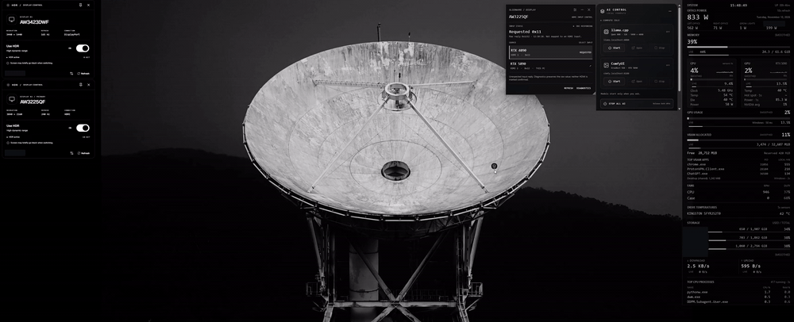
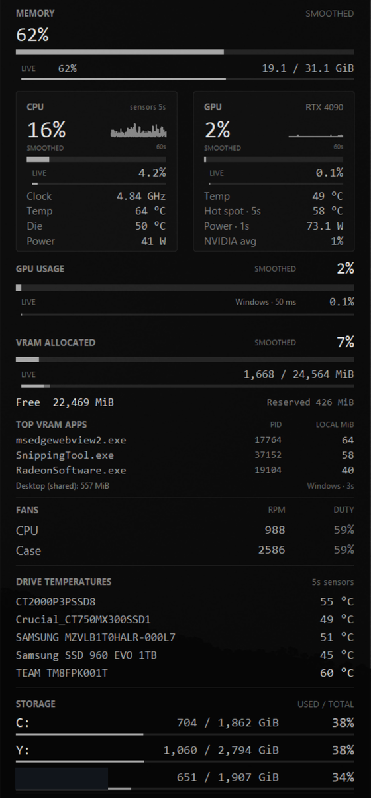
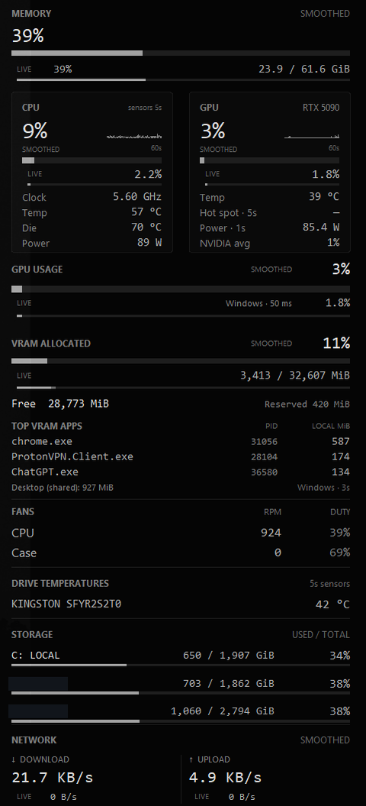
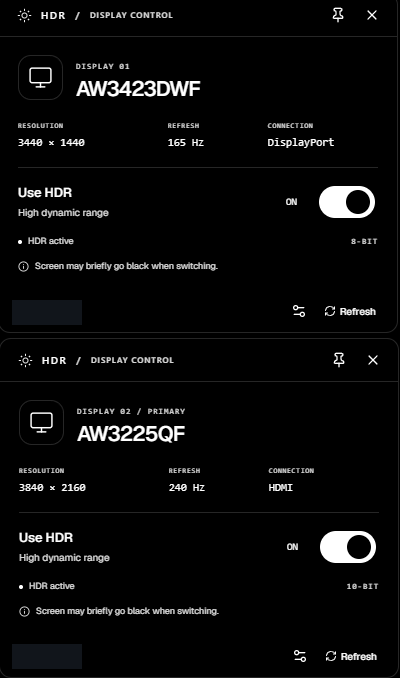
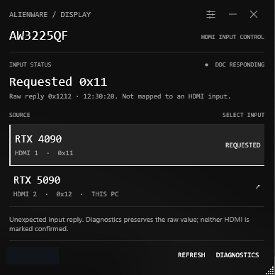

# Tools I keep on the desktop

The two workstations share a desk, monitors, and a recurring question: what is using the GPU right now? These small tools keep the readings and controls nearby. They run locally and have different jobs; hiding their windows should not stop a collector or unload a model.

*[Open or download the short recording](../images/widget-dock.mp4), or view the [still frame](../images/widget-dock.jpg). Host labels are redacted; window movement and displayed readings are unchanged.*

## SysWidget

SysWidget is a Python/Tkinter monitor with independent background collectors. It shows CPU and GPU activity, temperatures, allocated VRAM, memory, storage, network traffic, and process readings. A quieter overview sits above the fast live values, while the small history graphs retain the unsmoothed samples.

  
  

The overview smoothing uses collection timestamps, so its behavior does not depend on how often the UI repaints. Missing data clears the affected reading. A history gap stays a gap instead of being joined into an apparently continuous measurement.

GPU utilization and GPU memory answer different questions. Windows scheduler counters show current engine activity; NVIDIA telemetry supplies a separate driver average and allocated, free, and reserved VRAM. An idle GPU can still hold a loaded model. Polling a driver counter faster does not shorten the counter's own sampling window.

Per-process GPU memory is another trap. Shared surfaces can be attributed to several processes, so adding those rows does not produce a reliable amount of reclaimable VRAM. The widget uses Windows local-memory attribution to help identify applications, then leaves NVIDIA's free-memory reading as the check after an application closes. It never terminates an application automatically.

Remote disk polling has its own failure boundary. Each share has one bounded worker, so a slow SMB call cannot freeze CPU readings or the interface. Old storage readings expire, and access denied is reported separately from an unavailable share. A previous native GPU-telemetry hang also showed why a responsive window is not proof that its collector is still updating. Process isolation for that collector remains a possible improvement.

## Display controls

HDR Control uses React, TypeScript, and Electron for a separate window on each monitor. A small Python backend calls Windows DisplayConfig. It resolves the monitor's stable device path before changing HDR and reads the state back before reporting success. Capability, connection state, and enabled state are separate pieces of information.

The input switch is a C#/WPF tool for the AW3225QF. It uses DDC/CI input-select commands and checks the monitor's EDID identity before targeting it. A request can be acknowledged without confirming which source is visible.

  
  

The input screenshot shows that distinction: `0x11` was requested, but the raw reply was `0x1212`. The tool preserves that unexpected value and leaves the input unconfirmed. Masking it down to one byte would create a plausible answer without establishing that it was correct.

Native monitor calls run in a short-lived worker with a deadline. A timeout leaves the result unknown; the app does not automatically switch back or keep retrying. That matters on a shared display, where a speculative retry can take the screen away from the machine being used.

## Widget Dock and AI Control

Widget Dock is a small React/TypeScript/Electron launcher with a restricted Python window adapter. It recognizes only the configured tools and rechecks window and process identity before hiding or restoring them. Collapse leaves their processes running. Expand can reopen a missing control window without starting its AI workloads.

The animation uses temporary window snapshots. Reduced motion is supported, and positions are constrained to an available work area after monitor changes. A detached helper restores hidden windows if the launcher crashes. Reconnection also checks ownership before transferring those windows to a replacement helper.

[AI Control](gpu-inference.md#the-control-window) starts and stops the inference projects explicitly. Its window lifecycle is separate from model lifetime. The dock and the display controls manage windows or monitor settings; they do not make decisions about which model should occupy the GPUs.

These are installed personal tools. This repository documents their behavior and failure cases; it does not contain distributable copies of the applications. The screenshots were captured from the running tools, and no HDR, input-switching, or process-termination tests were run while preparing this update.
