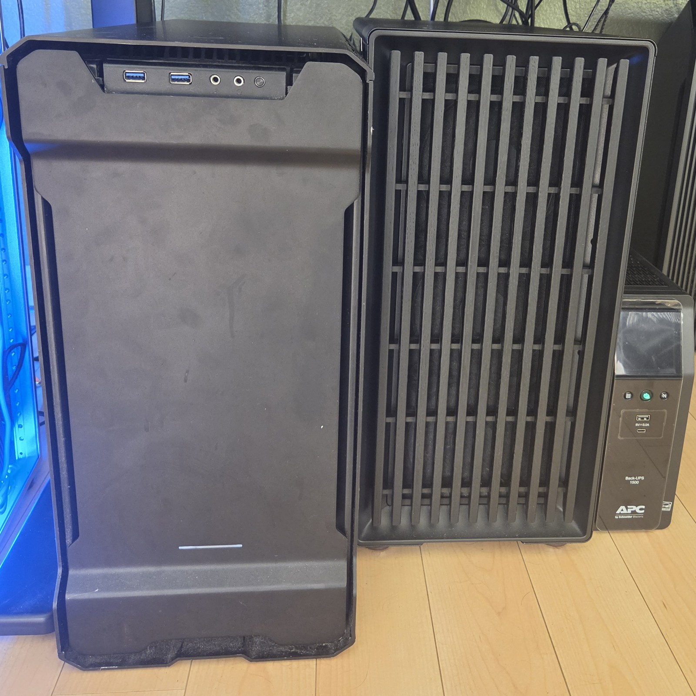
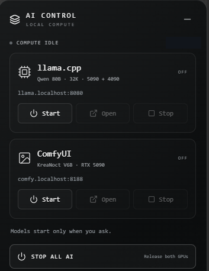

# Inference across two workstations

I have an RTX 5090 workstation with 64 GB system RAM and an RTX 4090 workstation with 32 GB. Native Windows llama.cpp runs a local CUDA backend on the 5090 and an RPC worker on the 4090. The cards have nominally 32 GB and 24 GB of VRAM, on separate machines connected by Ethernet.

  

*The two workstations beside the rack, November 10, 2026. Original photograph, cropped.*

## Why split the workload

The installed Q4_K_M 80B model file is about 48.4 GB, before runtime allocations. It does not fit on either card alone. Layer splitting makes use of hardware I already have, while keeping the HTTP API on the coordinator's loopback interface.

The existing launch profile uses one parallel slot and a 56:44 split in the verified order of local CUDA device, then remote RPC device. That split came from recorded buffer placement and free-memory checks, not just adding the advertised VRAM capacities. Desktop applications also use these GPUs.

The RPC transport is experimental and is not authenticated or encrypted. Its intended deployment is a narrowly restricted trusted connection. A firewall restriction is still not transport authentication. The public examples do not open ports, change routes, start workers, or download model weights.

## The control window

  

*AI Control on November 10, 2026. Both projects are off. The profile label describes the selected configuration, not an active inference session.*

The React/TypeScript/Electron control window keeps model startup explicit. Opening it, or restoring it through [Widget Dock](desktop-tools.md#widget-dock-and-ai-control), does not allocate the GPUs. Closing the window also does not implicitly stop a running model.

The main process accepts a fixed set of project actions through restricted IPC. Before stopping a process, it checks that the process belongs to the configured project. Switching workloads includes releasing the previous allocation; a failed or unconfirmed remote shutdown must remain visible instead of reporting that both GPUs are free. The existing route guard is part of this launch path, which is why the configuration drift below matters.

The [SysWidget readings](desktop-tools.md#syswidget) help distinguish low GPU utilization from available VRAM. The [Grafana history](monitoring.md#following-a-reading) provides a longer view of load, temperature, and power.

## What has been tested

The existing November 1 and 2, 2026 validation files contain actual inference responses from a Qwen3-Next-80B-A3B-Instruct derivative in Q4_K_M format. The build is pinned to llama.cpp commit `785322d17f2d51e5185cf996a1f4e46d87640841`. Device logs show 49 of 49 transformer layers offloaded across the two GPUs, with a small CPU-mapped token-embedding buffer remaining.

The tests also exercised switching between the distributed LLM and a separate ComfyUI workload on the 5090. ComfyUI does not use llama.cpp RPC to pool the worker's memory. The control application stops only processes belonging to these projects, checking process identity before termination.

A small local coding test initially exhausted an 8,192-token working context through repeated compaction. With a 32,768-token profile, the agent read the fixture, reproduced a failing test, edited the source, and passed an independent test rerun. That is evidence of basic tool use on one fixture, not a coding benchmark or a full-context stress test.

I am leaving throughput figures out of this overview. The saved measurements are short runs with specific inputs, and a cached model reload was slower than the first load. The reason for that loading behavior remains unresolved.

References: [llama.cpp RPC](https://github.com/ggml-org/llama.cpp/tree/master/tools/rpc) and [multi-GPU documentation](https://github.com/ggml-org/llama.cpp/blob/master/docs/multi-gpu.md). Model files and publisher licenses remain outside this repository.
