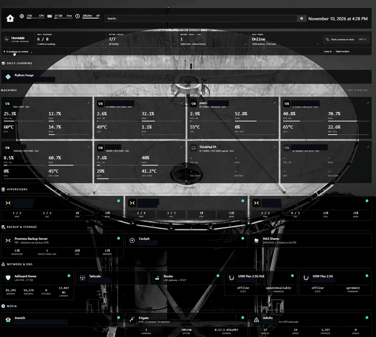
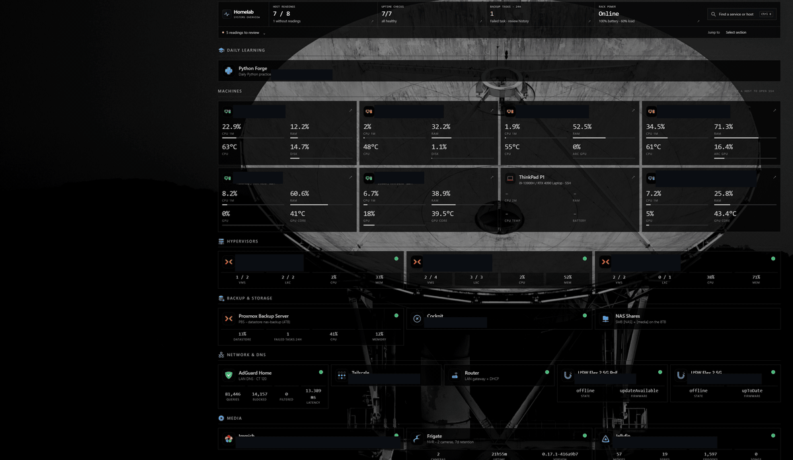
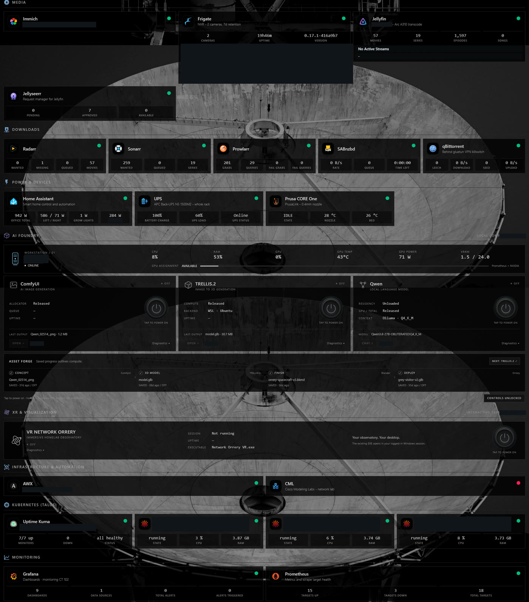

# Homepage and the services behind it

[Homepage](https://github.com/gethomepage/homepage) is the first page I open to check the lab. It runs on the Fedora NAS host and brings together service links, host telemetry, backup status, and controls for workloads I start on demand. The dark theme and navigation are customized; the service integrations still come from Homepage and the existing collectors.

*An eight-second scroll through the dashboard. [Open or download the MP4](../images/homepage-scroll.mp4), or see the [overview screenshot](../images/homepage-overview.jpg) and [first frame](../images/homepage-scroll.jpg). Private labels and camera events are covered; readings and service states are left as captured.*

## Making the summary useful

The custom React navigation layer adds a keyboard finder, section navigation, and local pinned items. It reads the existing widget results instead of creating another polling service or another place to store credentials.

The wording matters. The top row says **host readings**, because six available readings out of eight configured machines does not establish that two machines failed. Kuma checks, backup task history, and UPS state have their own meanings. A successful ping to a switch and an offline state reported by its controller can coexist; neither should silently overwrite the other.

Backup task failures need inspection even when recent snapshots exist. The task counter in this capture and the separate [backup freshness audit](../automation/README.md#backup-freshness) answer different questions: did a job report a failure, and does every expected guest have a recent backup? Neither confirms a successful restore.

One actual integration failure was less dramatic: the Grafana widget was using the older API configuration and receiving a 404. Updating its configured API version restored the response. A reachable web interface had not established that the dashboard integration was working.

Host tiles also launch native SSH sessions from the workstation. The browser is the starting point; authentication and the shell remain in the SSH client.

*Selecting host tiles opens separate terminal sessions. [Open or download the recording](../images/homepage-ssh.mp4), or view the [first frame](../images/homepage-ssh.jpg). Usernames, host labels, addresses, and login history are covered in this public copy.*

## What runs behind the tiles

**Photos and media.** Immich runs in a Proxmox container, with its database on local SSD storage and originals on the NAS over NFS. Those are separate recovery dependencies, covered in the [storage notes](proxmox.md#backups-and-the-photo-library). Jellyfin has a read-only media mount and access to an Arc A310 on its host. Frigate supplies NVR status to Homepage and Orrery; camera events and images stay out of the public captures.

**Network and power.** AdGuard Home provides local DNS from a Proxmox container in the HA group. Kuma checks DNS separately from host reachability. Home Assistant, the UPS integration, and the printer tile make power and device state visible alongside the servers. The office power total includes more than the GPU workstations, so it must not be read as GPU power draw.

**Automation and experiments.** AWX runs in Talos, with the same local-volume constraints described in the [cluster notes](talos.md). Python Forge is a small daily-practice application in its own container. Cisco Modeling Labs is an on-demand network lab; its VM was stopped during inventory. A stopped experiment does not need the same alert policy as DNS or photo storage.

**Local AI.** The captured Homepage has a separate Ollama, ComfyUI, and TRELLIS control area, with its workloads off. Saved image and model artifacts remain visible after compute stops. This is distinct from the newer [llama.cpp control window](gpu-inference.md#the-control-window), whose distributed profile spans the 5090 and 4090. A saved output or a configured button is not evidence that a model is currently resident.

Service, compute, and Kubernetes panels

*The remaining panels from the same capture. Private labels and camera-event history are covered. This records the dashboard's displayed state; it is not an independent health test of every listed integration.*

The main limitation is the shared dependency on the NAS and upstream collectors. Homepage is convenient, but it cannot be the only way to discover that its own host is unavailable. The [monitoring notes](monitoring.md) cover source freshness and unknown states; [Kuma](../kubernetes/uptime-kuma/README.md) provides a separate view of service checks.
