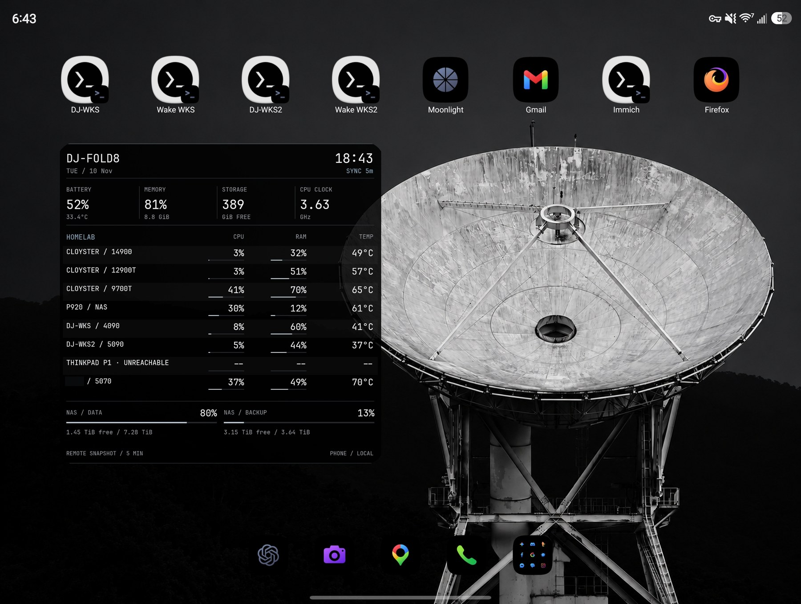
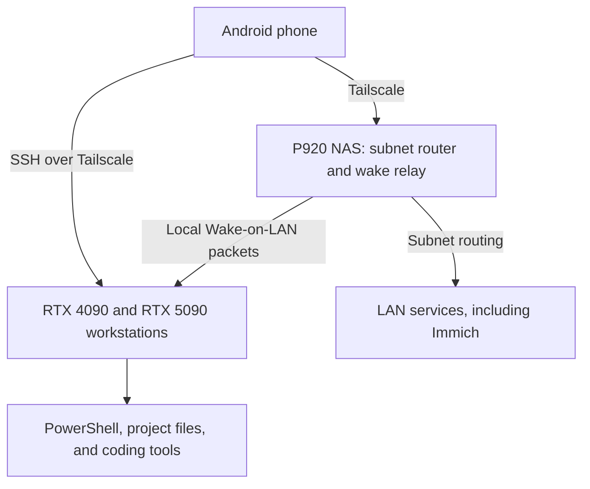
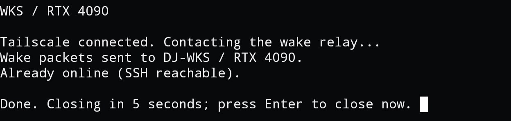
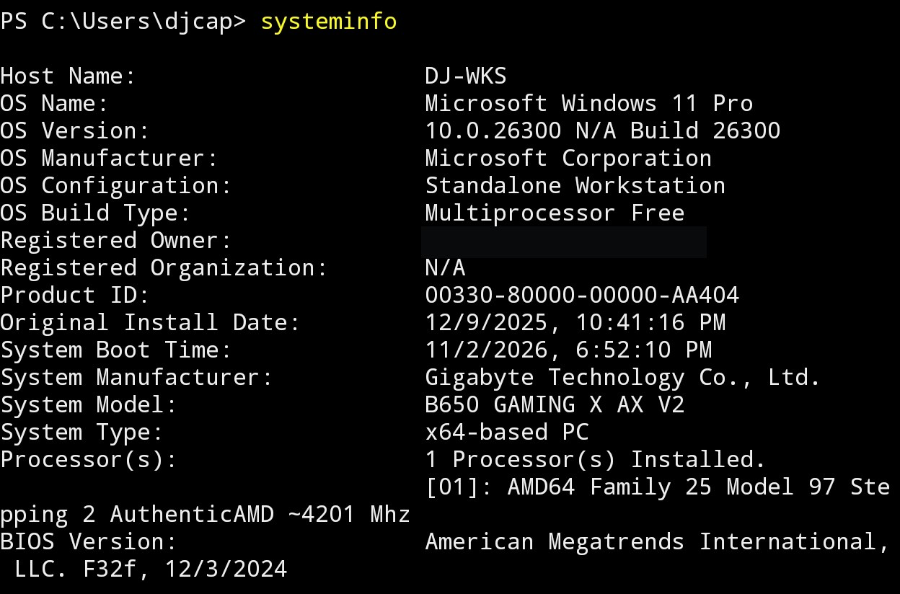
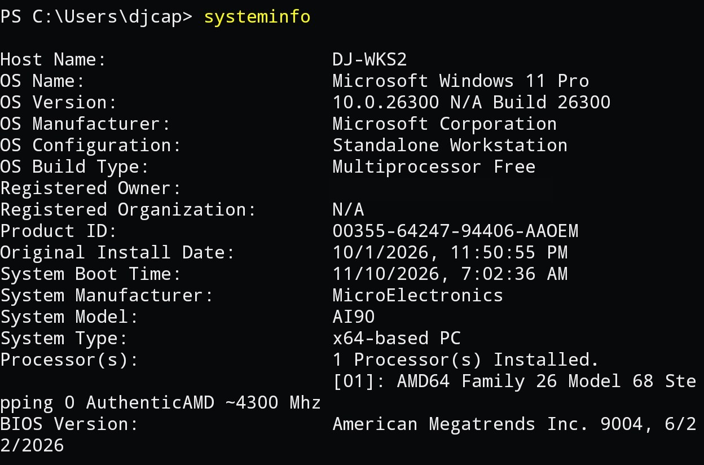
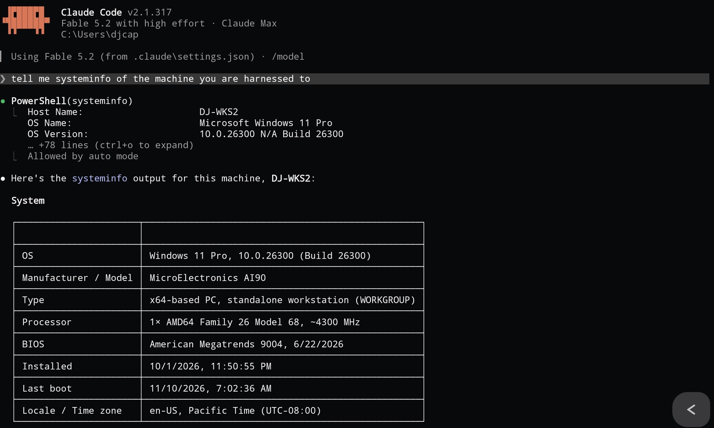
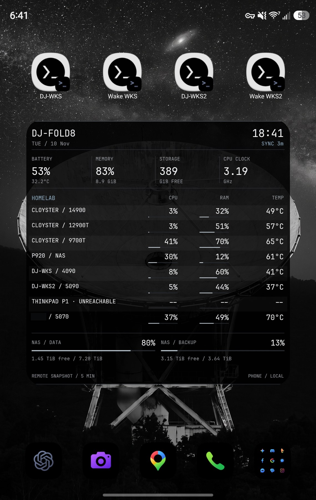

# The lab from my phone

The phone gives me a quick way to check the lab, wake a workstation, and open its terminal when I am away from the desk. The commands run on the machines at home, with their installed tools, project files, and GPUs. A small screen is enough for a service check or a coding session that does not need the full desktop.

## The route home

The phone, P920 NAS, and both Windows workstations run Tailscale. Workstation SSH can use their Tailscale addresses directly. P920 also advertises the home LAN subnet, so I can reach services such as Immich without installing a VPN client in every guest. This is the [subnet-router model](https://tailscale.com/docs/features/subnet-routers).

These are ordinary OpenSSH sessions carried over Tailscale, with SSH keys and host-key verification. Tailscale's separate SSH authentication feature is disabled on P920. The terminal shortcuts have LAN and Tailscale targets; the remote path does not require a public SSH port or a browser terminal exposed to the internet. [SSH over Tailscale](https://tailscale.com/docs/reference/ssh-over-tailscale) describes that distinction.

P920 is a dependency for the routed LAN services and the wake relay. An already-running workstation has its own Tailscale connection, so its direct SSH path does not pass through P920.

## Waking the workstations

There are separate wake buttons for the 4090 and 5090 machines. The Termux launcher connects Tailscale if needed, then sends a short SSH request to P920. A source-restricted key runs a fixed relay command instead of granting an interactive shell. The relay accepts only `wake` or `status` for the two configured targets.

P920 does the actual packet blasting on the home LAN: three rounds to both Ethernet MAC addresses of the selected workstation, using UDP port 9. Each magic packet contains six `FF` bytes followed by sixteen repetitions of the target MAC. Sending from the NAS keeps that broadcast local while the phone can be elsewhere.

The relay checks TCP port 22 over Tailscale before sending and waits up to 45 seconds afterward when necessary. It distinguishes an already-running PC, a machine that becomes reachable, and a timeout. The screenshot shows the first case. The 4090 has also passed a real S3 sleep-and-wake test; the equivalent 5090 sleep test remains unverified. The NAS must stay on, and the target needs power, Ethernet, and working NIC wake settings.

## A workstation terminal in my pocket

The two SSH shortcuts open PowerShell on the selected machine. These captures show `systeminfo` from DJ-WKS and DJ-WKS2. I can inspect processes, read logs, edit a project, or run installed command-line tools in that session.

  
  

Claude Code works in the same remote terminal. In this capture, it runs `systeminfo` on DJ-WKS2 and reports the result. Its tools operate against the workstation's shell and files while its configured model provider handles inference. The phone supplies the interface.

The separate [local inference setup](gpu-inference.md) runs llama.cpp on the workstation GPUs. Remote terminal access gives me a way to operate those tools too, with model loading kept explicit and the coordinator's HTTP API on loopback. The raw RPC worker remains an internal component, not a public mobile endpoint.

## Monitoring without opening a terminal

  

The KWGT widget combines phone-local readings with a cached snapshot from the existing Prometheus collectors. The NAS serves the remote snapshot through a restricted Homepage route. A five-minute refresh bucket lets the fields share one request instead of polling every host separately.

The display includes sample age and distinguishes unreachable hosts from missing or stale data. Android can delay refreshes, so this is a glance at the lab rather than an alerting system. [Kuma and Grafana](monitoring.md) handle the more detailed checks.

The remaining checks are practical: repeat the wake sequence on the 5090, test the complete flow over cellular, and verify reconnection after a phone restart. These captures show the working interfaces; they are not an offsite availability test.
