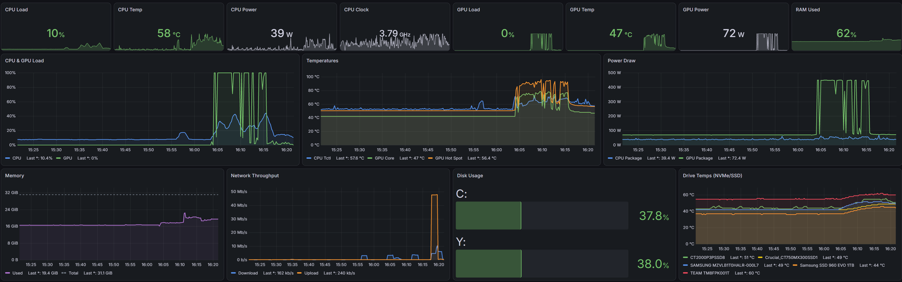
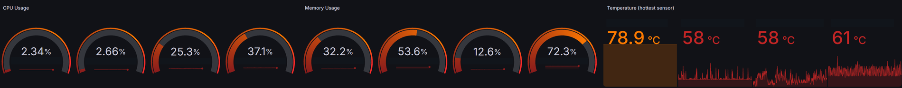

# Monitoring the service and the monitor

Prometheus and Grafana run in a Proxmox container. They collect host, Windows, hardware, Proxmox, and custom dashboard telemetry. Uptime Kuma runs separately in Kubernetes and checks service availability. The rack display gives me a quick view of the lab without opening several management pages.

The useful distinction is between a service failure and a monitoring failure. A collector that cannot authenticate, gets an empty response, or stops updating must not produce a reassuring green tile.

*The RTX 4090 workstation dashboard, November 10, 2026. This is an ordinary captured time window, not a controlled workload or a performance comparison.*

## Following a reading

The workstation dashboard combines Windows and hardware exporter data. CPU and GPU activity, temperature, power, memory, disk, and network history make it easier to ask what changed together. A temperature rise alongside sustained GPU use is useful context; it does not identify the application or establish the cause on its own.

*Host summary from the cluster dashboard. The four monitored machines include the separate NAS; they are not four Proxmox nodes. Address labels are covered.*

The [Homepage summary](homepage.md) and [Orrery](network-orrery.md) reuse these monitoring sources. Agreement between three displays is therefore not three independent health checks. When they disagree, I check the source, collection time, and aggregation window before treating one display as authoritative.

For availability, [Kuma's DNS and HTTP checks](../kubernetes/uptime-kuma/README.md#what-the-checks-tell-me) provide a different view. A host can be reachable while DNS queries time out, and an HTTP endpoint can answer while a background job is broken. The check has to match the failure I want to detect.

## A small collector with a real failure case

The existing Kuma-to-dashboard collector reads Kuma's authenticated Prometheus endpoint and writes a compact JSON feed. An earlier shell implementation could interpret an error response as zero monitors and report `0/0 up`. The current Python collector checks the HTTP status and requires actual monitor samples. Pending checks are separate from healthy checks.

Each output includes the producer's observation time. The file is written beside its destination and atomically replaced. On the Fedora host this also avoids a temporary file arriving with an unsuitable SELinux label; the collector restores the destination label after writing.

The collector runs every minute. A persistent failure is shown in the feed rather than sending an email on every failed invocation. That avoids a notification storm while preserving the failure signal. A consumer still needs to check the timestamp: yesterday's successful feed is not today's status.

## What the current snapshot establishes

The November 10, 2026 check found Grafana healthy and Prometheus scraping the rack and the two main workstations. Some client targets were unavailable. Several machines in this lab are used on demand, so target intent needs to be part of an alert policy. A failed scrape alone cannot distinguish a sleeping laptop from an unexpected outage.

Kuma's timestamped feed reported seven of seven checks up at that moment. This is a point-in-time observation, not an uptime percentage. Prometheus had no firing alerts in the sampled response, which says little about whether every useful failure has an alert rule.

## Improvements to test

- Add a freshness check for the dashboard feed, including an explicit unknown state when the producer timestamp is missing or too old.
- Separate always-on services from client machines in alert expectations, with a documented maintenance or off state.
- Test notification delivery and collector failure deliberately in a disposable environment.
- Add Kubernetes resource metrics; host-level graphs do not replace pod requests, limits, and usage.

The [Kuma example](../kubernetes/uptime-kuma/README.md) adds proposed startup and readiness checks. Those confirm that the application answers locally; its configured monitors still determine whether the services it watches are reachable.
