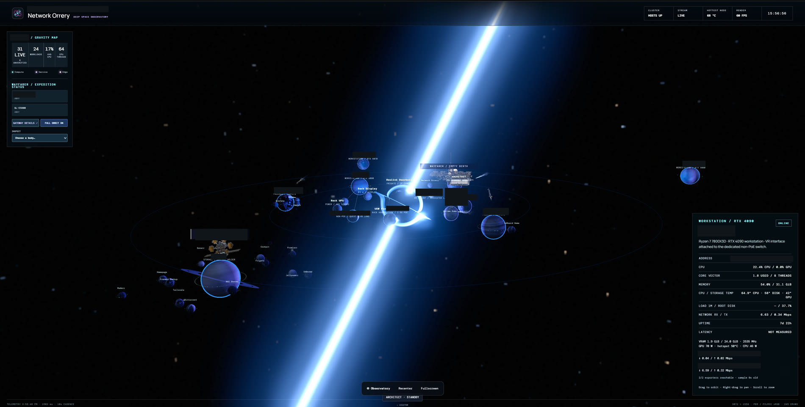
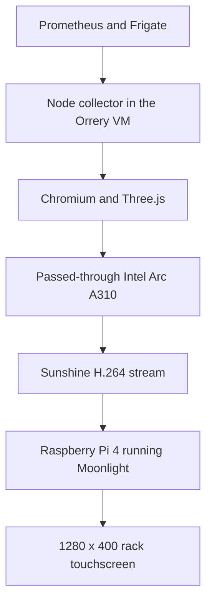
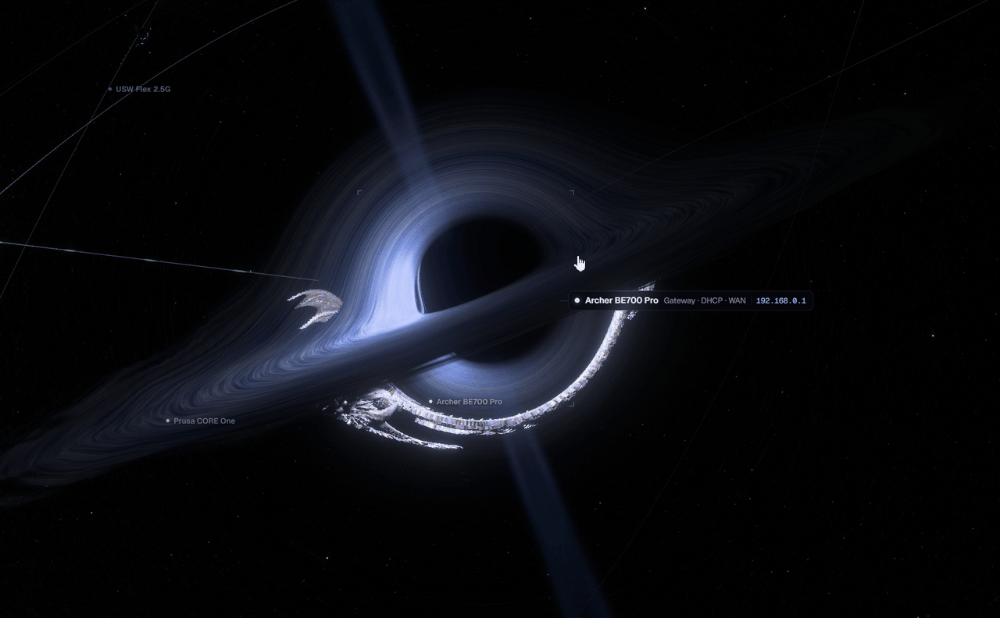
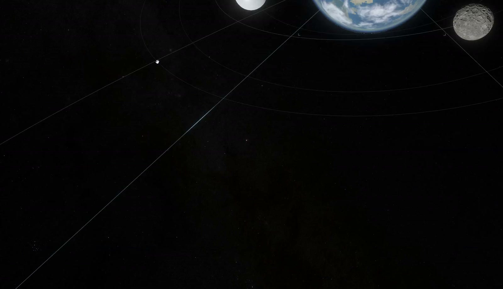

# Network Orrery

An orrery is a mechanical model of a planetary system. Mine is a slightly unreasonable way to look at a home network. Hosts become planets, guests and services become moons, and the gateway sits at the center. Selecting a body brings up the monitoring data behind it.

*Rack edition, captured November 10, 2026. Private names and addresses are covered. The scene and its readings are from the running application.*

## From telemetry to the rack display

The rack edition uses TypeScript, Three.js, and WebGL2, with React controls. A Node backend collects the existing Prometheus and Frigate feeds and supplies a same-origin snapshot to the browser. Keeping collection behind that interface gives the renderer one data shape to handle and keeps monitoring endpoints out of browser configuration.

The scene separates workload ownership from network connections. A VM belongs to its physical host; a switch connection describes a different relationship. Orbits, beams, and spacecraft make those relationships visible, but they are symbolic. They do not trace individual packets or measure cable latency.

The P330 Tiny hosts the Debian VM, renderer, and encoder. The Pi decodes the stream and returns touch input. This puts graphics work on the Arc while keeping the small panel as the display endpoint. The Arc used here is a separate device from the one available to Jellyfin on another Proxmox host.

The VM's application, display, renderer, and Sunshine services were all running during the November 10 read-only check. Its snapshot reported live source data. The Pi display path is documented in the existing deployment and validation notes; client-side service status was not reverified during this review.

## Losing the feed should be obvious

The topology remains visible when monitoring fails, but old utilization and health readings are discarded. The renderer's stale-data path preserves identity and geometry, changes source health to unknown, and waits for a fresh snapshot. A separate presence update cannot make an old full snapshot current again.

There are also separate signals for LAN gateway reachability and internet reachability. Being able to reach the router does not prove that traffic can leave the house. Objects without a direct health signal remain unverified instead of becoming healthy just because they have a place in the scene.

This is still a display with dependencies. The VM, monitoring feeds, network, encoder, and client can fail independently. Grafana and the underlying service interfaces remain useful when the graphics path needs troubleshooting.

## The workstation version

Kerr Orrery is a separate TypeScript/WebGPU renderer on the RTX 4090 workstation. It reads the rack collector and additional read-only metrics through its own local server. Its rendering work includes curved-ray tracing around a spinning black hole, GPU picking, procedural materials, and an HDR output path. The rack edition uses a different graphics implementation.

*Five-second preview from my recording. [Open or download the eight-second MP4](../images/kerr-closeup.mp4), or use the [still frame](../images/kerr-closeup.jpg). This capture is SDR and does not demonstrate the renderer's HDR output.*

*A [six-second planet view](../images/kerr-tour.mp4) from the longer workstation recording. A planet represents a host; its moons represent guests and services.*

This part of the project is also an excuse to work on graphics. The dragon is decoration, not a network device. The physics-inspired rendering has deliberate visual liberties, and the recordings are demonstrations rather than frame-rate benchmarks.

The next useful work is a public, sanitized source extract for snapshot freshness and a repeatable reconnect test across the VM-to-display path. Neither is packaged here yet. For the operational side, see [monitoring](monitoring.md) and [Proxmox recovery](proxmox.md).
