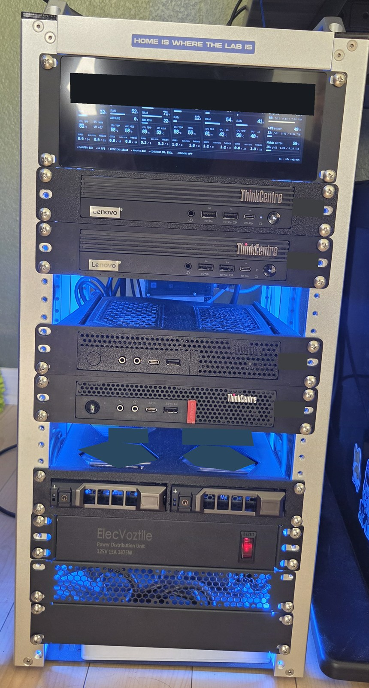
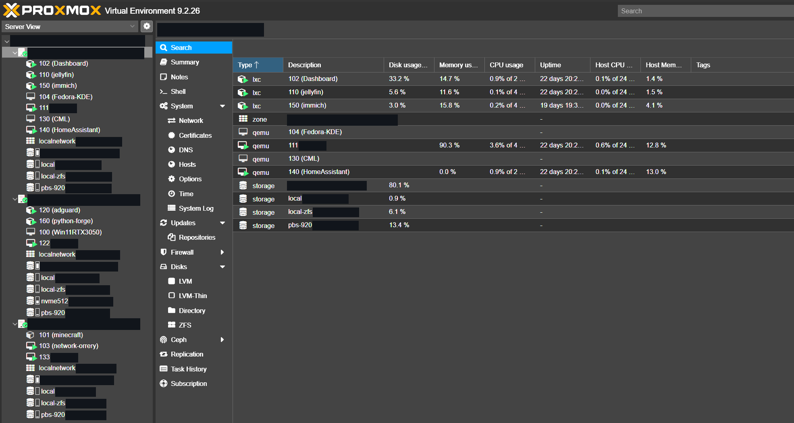

# Proxmox, storage, and recovery

The three-node Proxmox cluster runs on two ThinkCentre M90q systems and a P330 Tiny. On November 10, 2026 all three were online and quorate on PVE 9.2.26. Fourteen guests were configured, ten running and four stopped. The stopped guests include desktop and network experiments; they are not failed production services.

Small machines make this practical to keep at home, but memory, PCIe slots, and disks are real constraints. Each host has a single-disk ZFS root pool. I use replication and backups with those limits in mind rather than treating a three-node cluster as a substitute for redundant storage.

  

*November 10, 2026. Original photograph, cropped with private screen headings, address labels, and disk identifiers redacted.*

*The three-host tree and one host's guest list. Names tied to the private network are redacted; guest states and resource readings are unchanged.*

Containers handle services such as monitoring, DNS, Immich, and Jellyfin. VMs provide separate operating-system boundaries for Talos, Home Assistant, network experiments, and the [Orrery renderer](network-orrery.md). The captured list includes stopped desktop and CML guests alongside running services. Keeping the distinction visible helps separate expected shutdowns from outages.

## What HA covers

Proxmox HA manages the three Talos VMs, the monitoring container, and the DNS container. Ten asynchronous ZFS replication jobs provide copies on the other hosts. Their configured interval is one minute. The observed jobs had no recorded failures, with some in progress at the time of inspection.

The interval is not a guaranteed one-minute recovery point. A backlog or network failure can make the usable copy older, and restarting a VM still takes time. All hosts share home power and networking. I have not measured an end-to-end recovery time for this portfolio.

GPU passthrough is another boundary. A VM using a particular PCIe device cannot simply move to any host and expect that device to follow it. The hardware-bound graphics workloads are outside this HA group.

## Backups and the photo library

Proxmox Backup Server runs in a Podman container on the Fedora NAS host. The guest jobs retain seven daily and four weekly backups. Desktop backups run separately from the evening job and use an existing memory guard, because backing up a stopped VM can still require host memory. The network simulation VM is explicitly excluded.

Immich runs in an unprivileged Debian container. Its database and application state live on local SSD storage; originals are on an NFS-backed library from the NAS. That library is an excluded bind mount in the guest backup configuration. Restoring only the guest would not restore the photographs.

The NAS has separate data and backup disks, but both are attached to the same host. Its file-copy jobs and Immich backup job returned successful exit status during this review. A mirror that propagates deletions does not provide historical retention. Snapshot listings and successful timers also do not prove that an application can be restored.

The [backup audit](../automation/README.md#backup-freshness) checks whether every expected guest has a recent snapshot. It deliberately reports missing or stale coverage separately from restore verification.

## Before recovering a guest

1. Establish quorum and locate the guest's current owner with `pvecm status`, `ha-manager status`, and `pvesh get /cluster/resources --type vm`.
2. Check storage health and the relevant replication job on each participating host with `zpool status`, `pvesm status`, and `pvesr status`. Record the last successful sync, not just the next scheduled run.
3. Identify external dependencies. For Kuma this includes the Talos VM and its local PV. For Immich it includes the database and NAS library. For a passthrough guest it includes the physical device.
4. Choose the recovery source and an isolated test destination before issuing a restore or migration. Do not start a second writable copy of a database against the same storage.
5. After recovery, verify application data and a useful operation. An HTTP response or running VM is only one check. Record what was recovered, what was lost, and the actual elapsed time.

These steps are a decision checklist, not an automated failover script. No restore, migration, or failure injection was performed while preparing this repository.

My next recovery test is a disposable Kuma restore followed by an Immich database-and-library restore. The acceptance criteria are explicit: preserved monitor configuration and history for Kuma, and database consistency plus sampled original-file checksums for Immich. Keep the measured results alongside the runbook when those tests are complete.

References: [Proxmox storage replication](https://pve.proxmox.com/pve-docs/chapter-pvesr.html), [Proxmox HA](https://pve.proxmox.com/pve-docs/chapter-ha-manager.html), and [Immich backup and restore](https://docs.immich.app/administration/backup-and-restore/).
